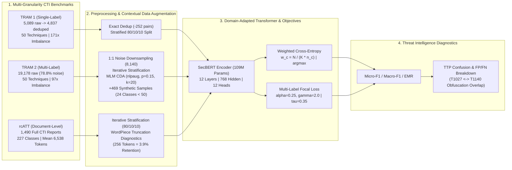
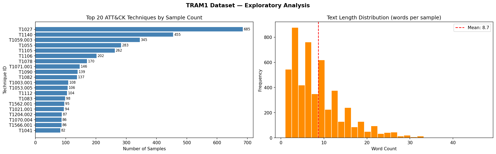
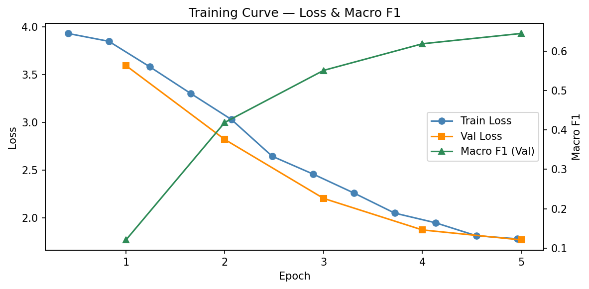
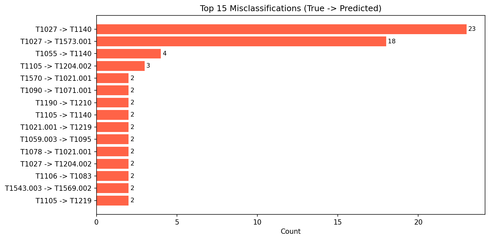
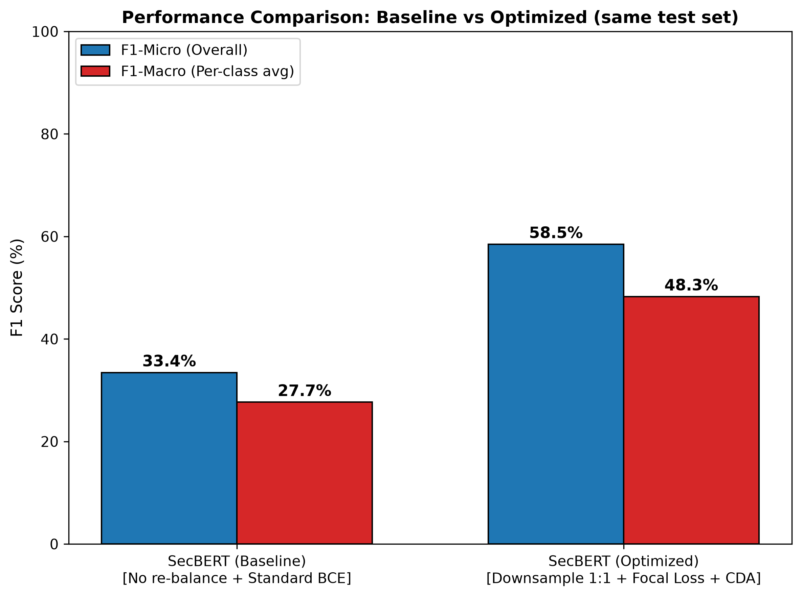
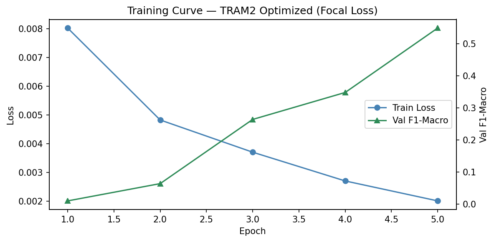
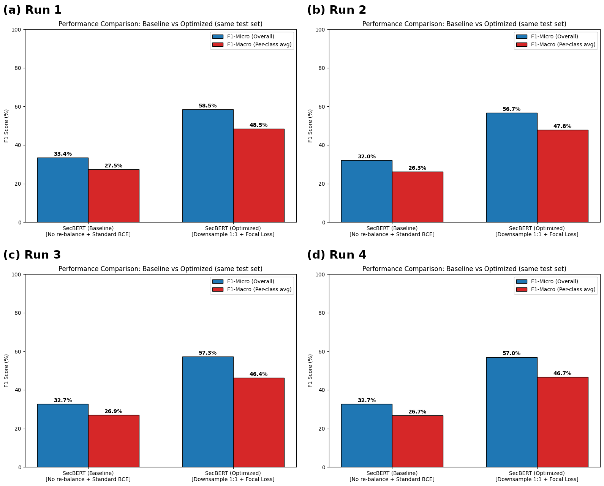
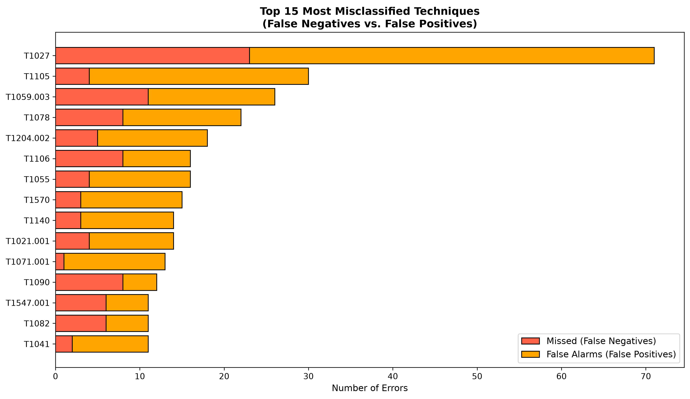
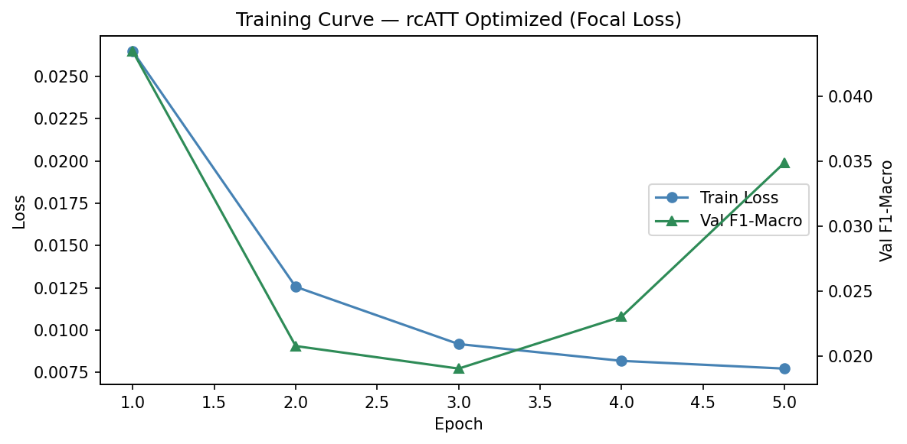
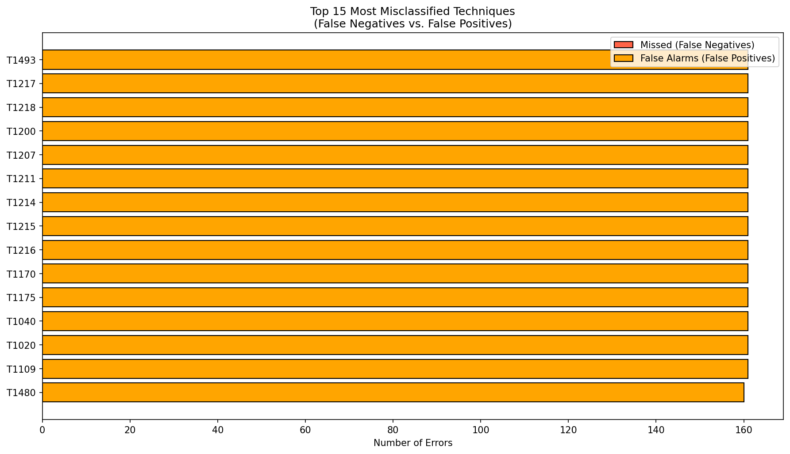

# Contextual Data Augmentation for Imbalanced Multi-Label Classification of MITRE ATT&CK Techniques Using Domain-Adapted BERT

[](https://attack.mitre.org/)
[-0A66C2?style=flat-square)](./paper/README.md)
[](https://www.python.org/)
[](https://pytorch.org/)
[](https://huggingface.co/nlpaueb/sec-bert-base)
[](./paper/main.tex)
[](./LICENSE)

> **An end-to-end Cyber Threat Intelligence (CTI) NLP research framework** that automates the mapping of unstructured threat reports into **MITRE ATT&CK Tactics and Techniques (TTPs)**. Evaluates a unified domain-adapted BERT backbone (`109M` parameters) integrated with **1:1 Background-Noise Downsampling**, **Iterative Stratification**, **Masked Language Model Contextual Data Augmentation (`nlpaug`)**, and **Task-Specific Loss Functions (Class-Weighted Cross-Entropy & Multi-Label Focal Loss)** across three public CTI benchmarks (**TRAM 1**, **TRAM 2**, and **rcATT**).
>
> 🏆 **Academic Milestone:** Research Abstract officially **Accepted** at *The 1st International Conference on Electrical, Electronics and Intelligent Systems 2026 (ICEEIS 2026 — IEEE Xplore Track, Submission ID: #228, HCM-UTE)*; extended full manuscript prepared in **Springer LNCS** format ([`paper/main.tex`](./paper/main.tex)).

---

## Executive Summary & Key Quantitative Findings

Automated TTP extraction from real-world Cyber Threat Intelligence faces four persistent operational challenges: **(1) extreme long-tail class imbalance** (up to $171\times$ ratio) and heavy unlabelled background noise ($78.8\%$ in TRAM 2), **(2) text granularity mismatch** between sub-sentence annotations and multi-page threat disclosures, **(3) semantic vocabulary overlap** between inverse adversary techniques within the same tactic, and **(4) domain vocabulary adaptation**.

| Benchmark | Classification Paradigm | Target Classes ($K$) | Primary Challenge | Proposed Strategy | Test Micro-F1 | Test Macro-F1 | Exact Match Ratio (EMR) |
| :--- | :--- | :---: | :--- | :--- | :---: | :---: | :---: |
| **TRAM 1** ([MITRE CTID](https://github.com/center-for-threat-informed-defense/tram)) | Single-Label Sentence (mean 8.7 words) | 50 | $171\times$ long-tail imbalance (4,837 deduplicated sentences) | Deduplication (-4.9%) + Inverse-Frequency Class-Weighted CE | **`0.6818`** | **`0.6160`** | **`0.6818`** |
| **TRAM 2 (Baseline)** | Multi-Label Sentence | 50 | $97\times$ imbalance + $78.8\%$ unlabelled noise | Positive-Weighted BCE ($\mathrm{pw}_c \le 50$, $\tau=0.50$) | `0.3344` | `0.2767` | `0.3821` |
| **TRAM 2 (Optimized — Best)** | Multi-Label Sentence | 50 | $97\times$ imbalance + $78.8\%$ unlabelled noise (19,178 raw $\to$ 8,140 1:1) | **1:1 Noise Downsampling + Iterative Stratification + CDA (+469 synth for 24 rare classes) + Focal Loss ($\alpha=0.25, \gamma=2.0, \tau=0.35$)** | **`0.5847`** (+74.8%) | **`0.4826`** (**+74.5%**) | **`0.6130`** |
| **TRAM 2 (4-Run Stability)** | Multi-Label Sentence | 50 | Seed sensitivity on rare TTP classes | 4 independent trials on identical test split | `0.5706 ± 0.0025` | `0.4666 ± 0.0016` | `0.6057 ± 0.0018` |
| **rcATT** ([Legoy et al., 2020](https://github.com/vlegoy/rcATT)) | Document-Level Multi-Label (mean 2,829 words) | 227 | Mean **6,538 WordPiece tokens/report** vs. 256-token BERT window | Quantified **3.9% token retention bottleneck** (99.5% of reports truncated) | `0.0905` | `0.0368` | `0.0000` |

---

## System Architecture & Unified Pipeline



---

## Experimental Results & Visual Evidence

### 1. TRAM 1 — Single-Label Sentence Classification ($K = 50$, $171\times$ Imbalance)

On **TRAM 1**, removing 252 exact-duplicate `(text, label)` pairs (4.9%) and applying inverse-frequency class-weighted cross-entropy ($w_c = \frac{N}{K \cdot n_c}$) enables smooth convergence across 5 epochs without synthetic oversampling, achieving **`0.6818` Test Micro-F1** and **`0.6160` Test Macro-F1**.



| TRAM 1 Training & Validation Curve | TRAM 1 Top-15 Misclassification Pairs |
| :---: | :---: |
|  |  |

---

### 2. TRAM 2 — Multi-Label Sentence Classification with 78.8% Background Noise ($K = 50$)

Raw **TRAM 2** contains 15,108 unlabelled background sentences (78.8%) alongside 4,070 labelled CTI sentences. Training directly with unweighted BCE causes **all-zero model collapse (`F1 = 0.0000`)**.
Our pipeline resolves this in three stages:
1. **1:1 Background-Noise Downsampling & Iterative Stratification:** Balances the 4,070 labelled sentences with 4,070 sampled unlabelled sentences (8,140 working corpus; Train: 6,513 / Val: 814 / Test: 814) while preserving multi-label co-occurrence.
2. **Contextual Data Augmentation (`nlpaug` MLM Substitution):** Targets the **24 minority ATT&CK techniques** with fewer than 50 training instances ($p = 0.15$, $\text{top-}k = 20$), synthesizing **469 contextually coherent CTI sentences** exclusively in the training split (6,982 total training instances).
3. **Multi-Label Focal Loss & Calibrated Thresholding:** Replaces positive-weighted BCE ($\mathrm{pw}_c = \min(\frac{n_c^-}{n_c^+ + \varepsilon}, 50)$) with Focal Loss ($\alpha = 0.25, \gamma = 2.0$) and a recall-calibrated decision threshold ($\tau = 0.35$), driving Test **Micro-F1 from `0.3344` $\to$ `0.5847` (+74.8%)**, **Macro-F1 from `0.2767` $\to$ `0.4826` (+74.5% relative gain)**, and **Exact Match Ratio from `0.3821` $\to$ `0.6130`**.

| TRAM 2 Baseline vs. Optimized Test Performance | TRAM 2 Training Progression (5 Epochs) |
| :---: | :---: |
|  |  |

#### Multi-Run Statistical Stability (4 Independent Trials)
Across four independent runs on the identical test split, the optimized configuration achieves **`0.5706 ± 0.0025` Micro-F1**, **`0.4666 ± 0.0016` Macro-F1**, and **`0.6057 ± 0.0018` EMR** (compared to Baseline `0.3224 ± 0.0031` Micro-F1 and `0.2649 ± 0.0028` Macro-F1):



---

### 3. Cybersecurity Domain Error Analysis: The `T1027` $\leftrightarrow$ `T1140` Obfuscation Overlap

Across both sentence-level benchmarks, granular False Positive (FP) and False Negative (FN) diagnostics expose **Defense Evasion semantic overlap** as the dominant error mode:
- **In TRAM 1:** Out of 154 total test misclassifications ($31.8\%$ error rate), two confusion pairs account for **26.6% of all errors**:
  - **`T1027` (Obfuscated Files or Information) $\to$ `T1140` (Deobfuscate/Decode Files or Information):** 23 instances.
  - **`T1027` (Obfuscated Files or Information) $\to$ `T1573.001` (Encrypted Channel: Symmetric Cryptography):** 18 instances.
- **In TRAM 2:** `T1027` accumulates the highest error volume across all 50 techniques (**71 total errors: 48 False Positives and 23 False Negatives**).
- **Root Cause:** `T1027` and `T1140` represent *inverse operational behaviors* within the malware execution lifecycle yet share near-identical technical vocabulary (`encoded`, `decoded`, `encrypted`, `packed`, `XOR`, `base64` payload). When evaluated on isolated 8.7-word sentences stripped of paragraph-level narrative context, short-window encoders struggle to disambiguate whether an adversary is obfuscating an artifact or deobfuscating it at runtime.



---

### 4. rcATT — Document-Level Architectural Truncation Analysis ($K = 227$)

On the document-level **rcATT** corpus (1,490 full CTI reports across 12 tactics and 215 techniques), reports average **2,829 words** (median 1,733; max 53,204), corresponding to a mean of **6,538 WordPiece tokens** when tokenized without truncation.
- A fixed 256-token BERT window retains only **3.9% of each CTI report's tokenized content on average**, silently truncating **99.5% of documents** to their opening executive summary.
- Consequently, while training loss converges smoothly under Focal Loss, validation Macro-F1 plateaus below `0.05` (Test Micro-F1 = `0.0905`, Macro-F1 = `0.0368`), providing quantified empirical proof that document-level ATT&CK mapping requires hierarchical sliding-window chunk pooling or sparse-attention long-document transformers (`Longformer` / `BigBird`, 4,096–16,384 tokens).

| rcATT Training Trajectory | rcATT Truncation-Driven FP/FN Profile |
| :---: | :---: |
|  |  |

---

## Repository Structure

```text
Secbert-cda-attack-classification/
├── dataset/
│   ├── README.md                              # Dataset documentation & statistics summary
│   ├── single_label.json                      # TRAM 1 single-label corpus (5,089 raw / 4,837 deduped, 50 classes)
│   ├── multi_label.json                       # TRAM 2 multi-label corpus (19,178 raw / 4,070 labelled, 50 classes)
│   └── training_data_original.zip             # rcATT document-level corpus (1,490 full CTI reports, 227 classes)
├── paper/
│   ├── README.md                              # Manuscript overview
│   ├── main.tex                               # Springer LNCS LaTeX manuscript source
│   ├── references.bib                         # BibTeX references (25 citations)
│   ├── figures/                               # 24 publication-grade plots across TRAM 1, TRAM 2, and rcATT
│   │   ├── README.md
│   │   ├── tram1/                             # EDA, deduplication, class weights, training curve, 50x50 CM, top errors
│   │   ├── tram2/                             # Downsampling, Baseline vs Optimized, 4-run stability grids, FP/FN errors
│   │   └── rcATT/                             # Document-level distribution, training curve, truncation error analysis
│   └── tables/
│       └── README.md                          # Full Markdown reproductions of Paper Tables 1–5
├── src/
│   ├── __init__.py                            # Package exports
│   ├── secbert_classifier.py                  # Core SecBERT classifier, FocalLoss, CDA (`nlpaug`), class/pos weights
│   ├── dataset_analysis.py                    # CLI inspector for TRAM 1, TRAM 2, and rcATT (imbalance & token truncation)
│   ├── train_tram1_single_label.py            # Reproducible training & error analysis pipeline for TRAM 1
│   ├── train_tram2_multilabel_cda.py          # Reproducible 1:1 Downsample + CDA + Focal Loss pipeline for TRAM 2
│   └── train_rcatt_doc_level.py               # Reproducible document-level pipeline & 256-token truncation analyzer for rcATT
├── .gitignore
├── CITATION.cff
├── LICENSE
├── README.md
└── requirements.txt
```

---

## Quickstart & Reproducibility

### 1. Environment Setup

```bash
git clone https://github.com/phat0x8/Secbert-cda-attack-classification.git
cd Secbert-cda-attack-classification
pip install -r requirements.txt
```

### 2. Run Multi-Benchmark Imbalance & Token Truncation Diagnostics

```bash
python src/dataset_analysis.py --benchmark all
```

### 3. Reproduce Experiments Across All Three Benchmarks

```bash
# 1. TRAM 1 (Single-Label, 50 ATT&CK Techniques, Class-Weighted Cross-Entropy)
python src/train_tram1_single_label.py \
    --data_path dataset/single_label.json \
    --model_name nlpaueb/sec-bert-base \
    --max_length 128 --epochs 5 --batch_size 32 --lr 2e-5 \
    --output_dir tram1_export

# 2. TRAM 2 (Multi-Label, 1:1 Noise Downsampling + nlpaug CDA + Focal Loss, tau=0.35)
python src/train_tram2_multilabel_cda.py \
    --data_path dataset/multi_label.json \
    --model_name nlpaueb/sec-bert-base \
    --max_length 256 --epochs 5 --batch_size 32 --lr 2e-5 \
    --minority_threshold 50 --eval_threshold 0.35 \
    --output_dir tram2_export

# 3. rcATT (Document-Level 227 Classes & 256-Token Truncation Measurement)
python src/train_rcatt_doc_level.py \
    --data_path dataset/training_data_original.zip \
    --model_name nlpaueb/sec-bert-base \
    --max_length 256 --epochs 5 --batch_size 32 --lr 2e-5 \
    --eval_threshold 0.35 \
    --output_dir rcATT_export
```

> **Note on Backbone Configurability:** Pass `--model_name jackaduma/SecBERT` or `--model_name ehsanaghaei/SecureBERT` to compare cybersecurity-pretrained checkpoints against the benchmark protocol default (`nlpaueb/sec-bert-base`).

---

## Citation

If you find this repository, experimental benchmark, or error analysis useful in your research or threat intelligence engineering, please cite:

```bibtex
@inproceedings{nguyen2026secbertcda,
  author    = {Nguyen, Tan Phat and Tran, Minh Khanh and Tran, Vu Hoang Long and Mai, Le Anh Thu},
  title     = {Contextual Data Augmentation for Imbalanced Multi-Label Classification of {MITRE ATT\&CK} Techniques Using Domain-Adapted {BERT}},
  booktitle = {1st International Conference on Electrical, Electronics and Intelligent Systems (ICEEIS 2026, Abstract Accepted, ID \#228) / Springer LNCS Extended Manuscript},
  year      = {2026},
  note      = {Faculty of Information Assurance, FPT University, Ho Chi Minh City, Vietnam},
  url       = {https://github.com/phat0x8/Secbert-cda-attack-classification}
}
```

---

## License & Contact

Released under the [MIT License](./LICENSE).

**Tan Phat Nguyen (`@phat0x8`)**  
Faculty of Information Assurance — FPT University (Ho Chi Minh City, Vietnam)  
- **GitHub:** [https://github.com/phat0x8](https://github.com/phat0x8)  
- **LinkedIn:** [https://www.linkedin.com/in/nguyen-tan-phat-6a4860252/](https://www.linkedin.com/in/nguyen-tan-phat-6a4860252/)
